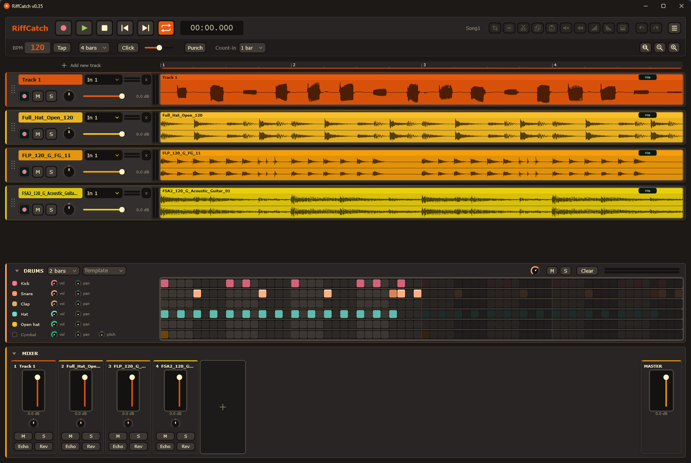
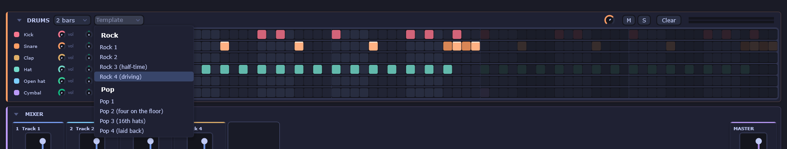
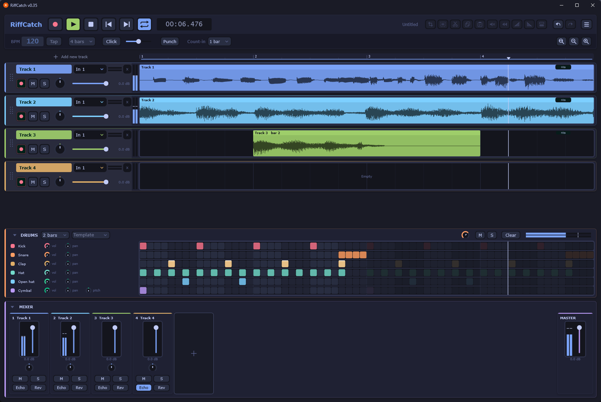

# RiffCatch

A lightweight multitrack looper and recorder for guitarists, built with JUCE and C++ for Windows. Plug in your interface (tested with a Focusrite 6i6 over ASIO), set a tempo, and layer riffs on top of a built-in drum machine.



## Features

### Recording and looping
- Up to 16 tracks, each with its own input selector, arm, mute, solo, volume and pan
- Loop lengths from 1 to 64 bars at 4/4, sample-synchronous transport
- Count-in, metronome click with volume, tap tempo
- Punch in/out recording
- Undo/redo for editing actions
- Autosave with restore prompt after a crash

### Drum machine
- 16-step-per-beat grid with Kick, Snare, Clap, Hat, Open hat and Cymbal
- Per-row volume and pan (pitch on Cymbal), master mute/solo and level meter
- 1, 2 or 4 bar patterns
- Template library (Rock, Pop and more), applied with undo support



### Editing
- Waveform editing with selection, crop, cut, copy, paste, fades and reverse
- Right-drag for fine clip positioning, drag the title strip to move a clip
- Ctrl+drag the title strip to duplicate a clip (snaps to bars, loop grows automatically)
- Snap to beats, bars or 1/16 with modifier keys
- Zoom with Ctrl+wheel, pan with Shift+wheel
- Import audio files (WAV and others) onto a new track by menu, drag and drop, or right-click in the empty area below the tracks

### Mixer
- Channel strips with level meters, fader, pan, mute, solo, plus Echo and Reverb sends
- Master strip with stereo meter

### Export and projects
- Projects saved as one WAV per track plus `project.json`
- Export mix to WAV or MP3 (LAME)

### Themes
- Nine built-in themes, switched from the File menu or with `Ctrl+Shift+O` / `Ctrl+Shift+P` (previous / next)



## Building

Requirements: Windows, Visual Studio 2022 (MSVC), CMake 3.22 or newer. JUCE 8.0.4 is fetched automatically by CMake.

```
cmake -S . -B build
cmake --build build --config Release --parallel
```

The executable ends up in `build/RiffCatch_artefacts/Release/RiffCatch.exe`.

### ASIO

The ASIO SDK cannot be redistributed. Download it from Steinberg and extract it to `third_party/asio_sdk` (so that `third_party/asio_sdk/common/iasiodrv.h` exists). Without it the build uses WASAPI only.

### MP3 export

MP3 export uses LAME (LGPL). Extract the LAME 3.100 source to `third_party/lame`. Without it the build has no MP3 export.

### Self test

```
RiffCatch.exe --selftest
```

Writes `selftest.txt` next to the executable and ends with `ALL OK` when everything passes.

## License

TBD.
